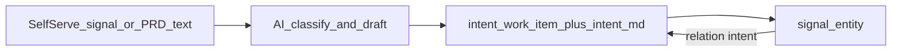

# Bonus skill: software-factory PRD intake

## What Port MCP shows today

Connected to **user-port-eu**. The live “software factory” does **not** use separate `prd` / `work_item` blueprints. The teaching model maps like this:

| Concept (your words) | Live Port model |
|---|---|
| Raw PRD / ticket / Slack ask | `signal` (raw_content, source, source_ref) |
| Work item / feature | `intent` (status plan→shipped, feature_key, priority, risk_*) |
| Generated PRD body | `intent.properties.document` (“intent.md”) |
| External tracker link | `intent.ado_work_item` + `intent.ado_url` (string/url props, not a relation) |
| Signal → feature link | `signal.relations.intent` → `intent` |

**Intake workflow:** `wf_plan` — *“Plan: capture a signal and assess its risk”* — self-serve form → dedupe signal → AI classify/draft intent.md + risk → fetch `eligibility_policy` → upsert `intent` → upsert `signal`.

**Downstream chain (mention in skill, do not ship):** `signal` → `intent` → `spec` → `plan` → `change` (plus `factory` / `stage_run` ops). Live org has ~32 intents and ~11 signals.

## Why a simplified bonus (not a dump)

Live `wf_plan` depends on `load_skill` (`write-intent`), `product.classification_brief`, and `eligibility_policy` rows. That is too heavy for Port 101. Mirror existing skills ([`skills/agentic-workflow/`](../skills/agentic-workflow/)): same shape, teaching-sized assets, soft prereq only.

**Default scope (chosen):** thin slice — `signal` + `intent` blueprints, mock product + sample entities, simplified generate-PRD workflow, short note on the full chain. No `spec`/`plan`/`change`/`factory` upserts.

## Deliverables

### 1. New skill folder

Create [`skills/software-factory-intake/`](../skills/software-factory-intake/):

- `SKILL.md` — YAML frontmatter + Steps / Done when / Manual fallback (same pattern as [`skills/agentic-workflow/SKILL.md`](../skills/agentic-workflow/SKILL.md))
- `assets/signal-blueprint.json`
- `assets/intent-blueprint.json` — include `document`, `feature_key`, `status`, `priority`, `ado_work_item`, `ado_url`, relation `product` (optional); skip live risk/quality/aggregation surface area
- `assets/product-blueprint.json` + 1–2 mock product entities (so the AI can pick an owner product)
- `assets/mock-entities.json` — 1 sample intent + 1 sample signal already linked (show the relation before the learner runs the form)
- `assets/workflow.json` — simplified `generate_prd_from_signal` (or similar id), distilled from `wf_plan`:
  - `SELF_SERVE_TRIGGER` (body, source_ref, optional source)
  - optional dedupe `WEBHOOK` search on `signal`
  - `AI` node that drafts title/description/`intent_document` (+ simple priority); **no** `eligibility_policy` / `load_skill` dependency
  - `UPSERT_ENTITY` intent, then signal with `relations.intent`
  - Optionally set `ado_work_item` from `source_ref` when source looks like ADO (keeps “PRD ↔ work item” concrete without an ADO integration)

### 2. Port AI companion entity

Add [`port-skills/software-factory-intake.json`](../port-skills/software-factory-intake.json) (`port-101-software-factory-intake`) — thin “trigger the workflow” instructions, same pattern as [`port-skills/agentic-workflow.json`](../port-skills/agentic-workflow.json).

### 3. README / curriculum framing

Update [`README.md`](../README.md):

- Keep the core five skills as the main tour
- Add a **Bonus** row for software-factory intake
- One sentence: optional after agentic-workflow; teaches cataloging product work (signals/intents), not services
- Soft note that blueprints are independent of `service` from catalog-foundations (no hard dependency)

### 4. Company context (light touch)

Add a short subsection to [`company-context.md`](../company-context.md) describing the fictional product-work domain (signals + intents) so the bonus has the same flavor as the service catalog story — without rewriting the whole file.

## Skill success criteria (“Done when”)

Learner runs “Generate PRD from signal” with sample PRD text → new `intent_*` entity with markdown `document` → related `signal_*` → optionally `ado_work_item` populated from the source ref → can open the intent and see it as the work item holding the PRD.

## Explicit non-goals

- Porting live `wf_design`, release gates, scorecards, or factory metrics
- Requiring Azure DevOps / GitHub integrations
- Mutating the learner’s existing production factory blueprints if identifiers collide — use Port 101-prefixed identifiers where needed (e.g. keep `signal`/`intent` only if the skill docs warn to run in a clean POC org, matching how other skills assume a workshop tenant)
- **Do not apply this skill to a Port org until explicitly asked** — plan and repo assets only for now
